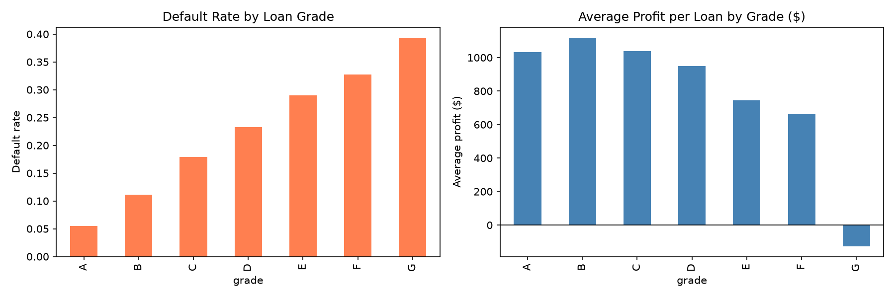
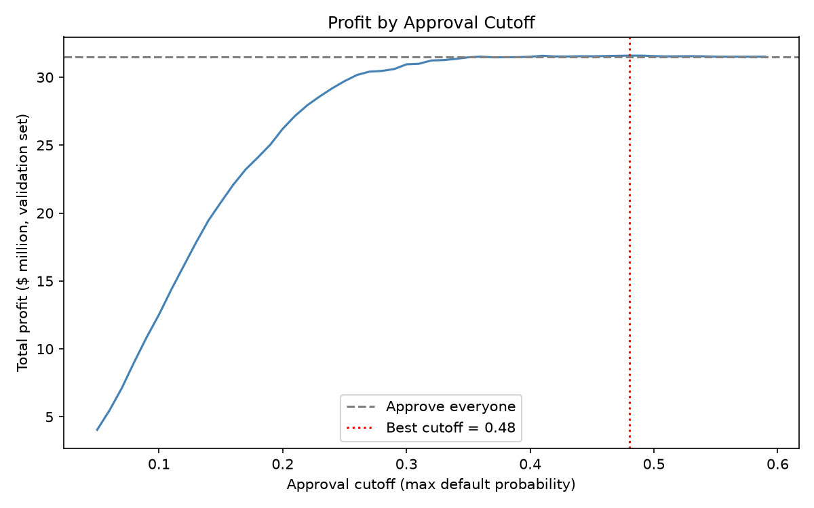
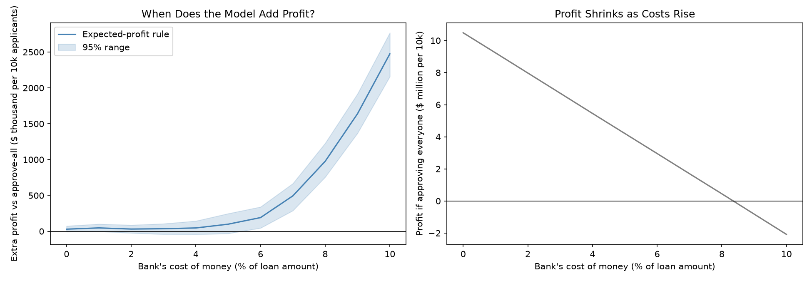

# Loan Approval Strategy: Finding the Approval Rule that Maximises Profit

## Problem Statement
A bank wants to decide which loan applicants to approve. Rejecting everyone
risky lowers defaults, but it also throws away good customers and the
interest they pay. This project asks: **does a default-risk model actually
increase profit, and under what conditions?**

Profit is measured from each loan's real cash flows, not from the default
label alone.

## Dataset
- **Source:** Lending Club accepted loans, 2007-2018 (Kaggle). (https://www.kaggle.com/datasets/wordsforthewise/lending-club)
- 1,345,310 loans ended as Fully Paid or Charged Off (19.96% default rate)
- **Kept 36-month loans issued 2012-2015 (589,488 loans)**, because these loans
  had finished before the data ends. Newer loans still running would show
  mostly early defaults and distort both default rate and profit.
- Random sample of 150,000 loans, split 60/20/20 into train, validation and test.
  Default rate is 13.9% in all three.
- **Currency:** US dollars

## Tools Used
Python, pandas, NumPy, scikit-learn, XGBoost, matplotlib, seaborn, JupyterLab

## Approach
1. Cleaned data and kept only loans with a final result
2. Calculated actual profit per loan = money received - money lent
3. Trained an XGBoost model to predict default (no resampling, so the
   probabilities stay trustworthy)
4. Checked that predicted probabilities match actual default rates
5. Built three approval rules and compared them on profit
6. Chose all settings on the validation set; used the test set once
7. Ran a sensitivity analysis on the bank's cost of money, with bootstrap
   confidence intervals

## Key Findings

### 1. Interest rates already pay for most of the risk
| Grade | Default rate | Average profit per loan |
|---|---|---|
| A | 5.5% | $1,033 |
| B | 11.1% | $1,120 |
| C | 17.9% | $1,040 |
| D | 23.3% | $950 |
| E | 29.0% | $745 |
| F | 32.7% | $661 |
| G | 39.3% | -$126 (only 117 loans) |

Default rates rise with every grade, but average profit stays positive up to
grade F. Grade B earns more per loan than the safest grade A. About 1 in 8
defaulted loans still made a profit, because those customers paid for a long
time before stopping.

### 2. The model predicts default well and its probabilities can be trusted
| Measure | Result |
|---|---|
| XGBoost ROC-AUC | 0.683 |
| Interest-rate-only benchmark | 0.659 |
| PR-AUC | 0.249 (random baseline 0.139) |

In all 10 risk buckets the predicted and actual default rates match closely
(for example 30.4% predicted vs 30.0% actual in the riskiest bucket). The
improvement over the interest-rate benchmark is modest, because Lending Club
had already priced risk into its rates.

### 3. With no funding cost, no rule clearly beats "approve everyone"
Test set, gain per 10,000 applicants over approving everyone ($10.50M profit):

| Rule | Approved | Gain |
|---|---|---|
| Grade rule (A to F) | 99.9% | $6,635 |
| Model cutoff (default probability < 0.48) | 99.9% | $10,525 |
| Expected-profit rule | 99.4% | $28,265 |

Bootstrap 95% ranges for these gains include zero. A strict risk rule that
approved only the safest loans (below 10% default probability) would cut
total profit by about 60%.

### 4. The model's value depends on the bank's cost of money
Cost of money is a % of the loan amount (funding plus servicing). Gain per
10,000 applicants over approving everyone, with 95% bootstrap range:

| Cost of money | Approve everyone earns | Expected-profit rule gain | 95% range | Clearly above zero? |
|---|---|---|---|---|
| 0% | $10.50M | $29K | -$12K to +$77K | No |
| 3% | $6.72M | $35K | -$45K to +$114K | No |
| 5% | $4.21M | $96K | -$32K to +$225K | No |
| **7%** | **$1.69M** | **$512K** | **+$316K to +$713K** | **Yes** |

- At about 8.4% cost, approving everyone stops being profitable.
- The model-cutoff rule shows the same pattern, with a smaller gain
  ($218K at 7%).

## Business Recommendation
> When the bank's margins are healthy, interest income covers defaults and
> a risk model adds no provable profit. When margins are thin (cost of money
> around 6% to 8% of the loan), a profit-based approval rule using the
> model, loan size and interest lifts profit from about $1.7M to $2.2M per
> 10,000 applicants. The bank should first measure its real cost of money,
> because that decides whether the model is worth deploying.

## Limitations
- **Only approved loans are in the data.** Rejected applicants are missing,
  so the results show how to screen approved loans, not new applicants.
- **Cost of money is an assumption.** Results are shown for 0% to 10%
  rather than for one claimed value.
- **Profit is gross and not discounted.** It ignores the time value of money.
- **Only 36-month loans from 2012-2015** were used. Results may differ for
  60-month loans or other years.
- **XGBoost used fixed settings** and was not tuned.
- **Bootstrap intervals only capture test-sample noise**, not model or
  assumption uncertainty.
- Two numbers in the expected-profit rule (81% of scheduled interest earned
  on paid loans, -$0.37 per $1 lent on defaulted loans) come from training data.
- No fairness or regulatory review was done. A real lending model would need one.

## Visualizations

## Author
**Riya Saini**
